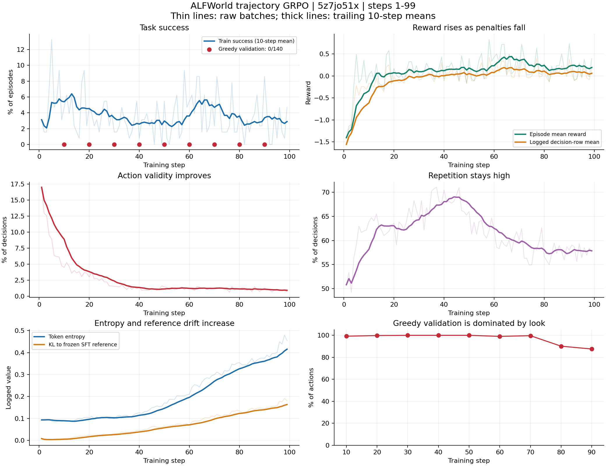

# ALFWorld 原版 trajectory GRPO 训练效益分析

采样时间：2026-09-27T18:53:03.021689+08:00。实验：5z7jo51x。分析范围：step 1–99。

结论：动作合法性显著改善，但尚无任务完成能力提升的证据；贪心验证陷入合法且不推进任务的循环。

| 指标 | step 1–10 | step 90–99 |
|---|---:|---:|
| 训练成功率 | 5.39% | 2.89% |
| 每批成功数（128 条） | 6.9 | 3.7 |
| 等权轨迹平均奖励 | -0.3372 | 0.1925 |
| critic/score/mean（决策行加权） | -0.6114 | 0.0605 |
| 非法动作占实际决策比例 | 8.89% | 0.91% |
| 重复有效动作占实际决策比例 | 58.17% | 57.86% |
| Token entropy | 0.0895 | 0.4155 |
| Reference KL loss | 0.00532 | 0.16344 |

实际运行配置来自 SwanLab 本地 config.yaml：原版 GRPO，entropy_coeff=0.01、kl_loss_coef=0.001，训练 temperature=1，验证 temperature=0 且 do_sample=false，val_before_train=false。

奖励公式为 R=10×success−0.2×(invalid+no_action)，重复动作不扣分。等权轨迹平均奖励已用导出记录逐轨迹复核；原生导出的空 padding 行已排除。
奖励增量约 +0.5297，由减少惩罚 +0.7797 和成功收益下降 −0.2500 构成。critic/score/mean 的权重是决策行，不能当作等权轨迹平均奖励。

step 10、20、30、40、50、60、70、80、90 在相同 140 个 valid_seen 任务上的成功数均为 0。每次均导出 140 条、各 50 步的完整轨迹。step 30–50 的验证动作全部是 look；step 90 的 look 比例为 87.59%，20 个任务从头到尾只输出 look。示例任务“put a clean soapbar in cabinet”连续 50 次 look。

最近 10 步的 160 个任务组中，142 组没有成功轨迹，其中 9 组所有奖励完全相同。大部分组内比较仅能区分失败轨迹扣分多少，缺少完成任务的正向示范。这与“减少非法动作、保持大量无效重复”的行为一致，属于机制解释，不能代替控制变量实验。

所有已记录标量均为有限值。Token entropy 持续增长不等于动作探索有效，也不能单独作为数值爆炸证据。梯度范数最近 10 步平均约 8.40，未见 NaN/Inf。

限制：本轮未做训练前验证；不能据此确定相对初始 SFT 的净增益或断言全部退化由 RL 导致。训练批次任务不同，其成功率趋势不是同任务配对评估；9 次验证重复使用相同任务，也不能当作 1260 个独立任务样本。

建议：先在相同任务和提示词下对照初始 SFT 与候选 checkpoint，并同时报告 greedy 与固定温度采样结果；然后优先处理无进展循环和成功信号不足，再做 KL/熵单变量实验。全局惩罚任何重复动作会同时惩罚必要的回访，应区分有任务进展的重复与无进展循环。

原始聚合结果：summary.json；逐步指标：training_metrics.csv；复现脚本：analyze.py。
